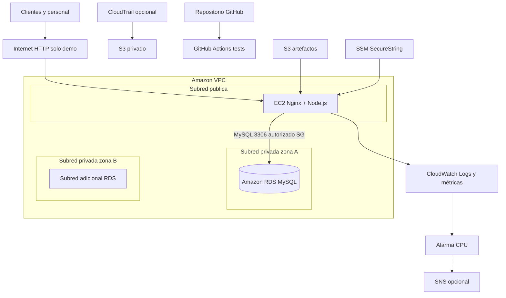

# Diseño general de la solución

La arquitectura es de demostración y separa redes, cómputo y datos. VPC incluye dos subredes privadas para el DB subnet group, pero la instancia RDS utiliza `MultiAZ: false`. Un único servidor EC2 no proporciona alta disponibilidad ni balanceo. CloudWatch observa logs y CPU; el agente incluye memoria si tiene permisos. Para una plataforma real se requiere HTTPS, alta disponibilidad, monitoreo avanzado, autenticación robusta y política de recuperación probada.
